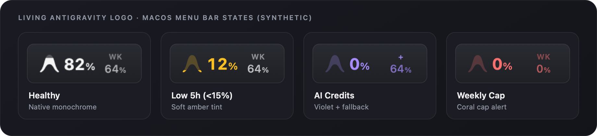
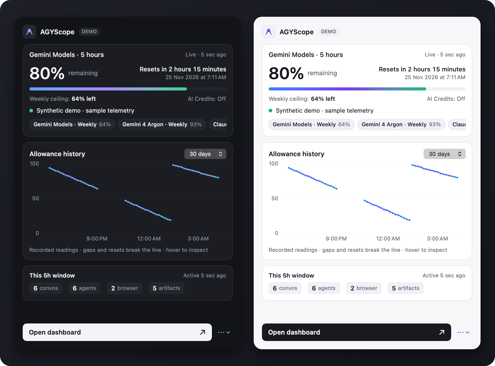
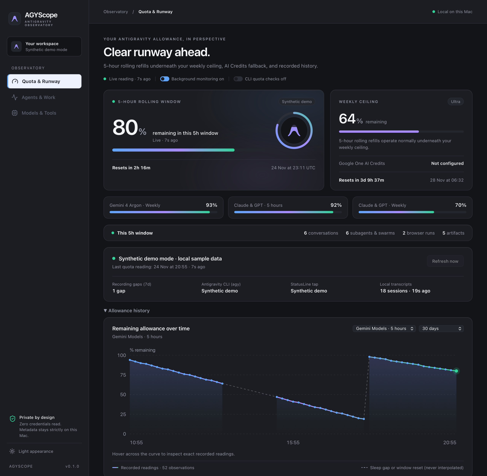

<div align="center">

# AGYScope

**A private, local usage observatory and native macOS menu bar meter for Google Antigravity.**

[](https://github.com/DicksonKam/agyscope/actions/workflows/ci.yml)


*Sibling of **CDXScope** (Codex) and [CCScope](https://github.com/DicksonKam/ccscope) (Claude Code) — built specifically for Antigravity's 5-hour rolling windows, overarching weekly ceiling, per-model pools, Google One AI Credits fallback, and agentic work footprint.*

</div>

---

### Living Antigravity Logo · macOS Menu Bar

The soaring Antigravity silhouette fills bottom-to-top with your **5-hour remaining %**, paired with a large bold **5h%** readout and a quiet stacked **`WK` / %** directly beside it. Native monochrome when healthy, shifting to semantic alert tints when low (`<15%` amber), drawing AI Credits (violet `+`), or weekly-capped (coral).



### Mission Control Popover · Dark & Light

Click the menu bar icon for your live 5-hour & weekly balance, reset countdowns, model-pool pills, interactive Swift Charts allowance history (`Current` / `7d` / `30d` / `90d`), and a live **"This 5h window"** strip tracking conversations, subagents/swarms, browser runs, and artifacts.



### Prismatic Obsidian Web Observatory (`127.0.0.1:4337`)

Quiet monochrome surfaces with the Gemini spectrum reserved strictly for live meters, the Living Antigravity radial orb, and recorded history curves across 3 pages: **Quota & Runway**, **Agents & Work**, and **Models & Tools**.



> *All screenshots above are rendered offscreen with synthetic data (`npm run snapshot:menubar`). AGYScope is an independent project, not affiliated with or endorsed by Google. Early preview, source builds only (locally ad-hoc signed, not notarized).*

---

## How It Reads Your Usage (Zero Credentials, Zero Tokens)

Once a minute, AGYScope asks the official Antigravity CLI (`agy`) for its structured usage report:

```sh
agy -p /usage --output-format json
```

`agy` answers locally with `num_turns: 0` and `total_tokens: 0`, so polling costs **zero tokens**. If a future CLI release ever spends model tokens answering `/usage`, AGYScope stops CLI reads automatically.

**AGYScope never reads, stores, or renews Google credentials and never contacts Google endpoints directly.** An automated test (`tests/usage-reader.test.ts`) fails CI if credential-reading or direct-endpoint code is introduced.

Two additional local sources add detail:

- **StatusLine tap (`npm run tap -- install`):** Optional hook for `~/.gemini/antigravity-cli/settings.json` that captures allowlisted `quota` fields piped by `agy` while chaining any existing status line command.
- **Local transcripts:** Incrementally scans `~/.gemini/antigravity/brain` and `~/.gemini/antigravity-cli/brain`, retaining only numeric token counters, model labels, and machine tool names (never prompts, replies, or thinking). See [PRIVACY.md](PRIVACY.md) and [SECURITY.md](SECURITY.md).

## Quick Start

Requires **macOS 13+**, **Node.js 22.13+**, **Apple Command Line Tools** (for the native menu bar app), and the signed-in official Antigravity CLI (`agy`).

```sh
# 1. Install dependencies and build
npm ci --ignore-scripts
npm run build

# 2. Install the native macOS menu bar app (~/Applications/AGYScope.app) & login service
npm run menubar -- install

# 3. Verify the full local chain
npm run doctor
```

Want to preview every screen, alert state, and chart immediately with synthetic data?

```sh
npm run demo
```

Optional: attach the official `agy` CLI `statusLine` hook (automatically backs up `~/.gemini/antigravity-cli/settings.json` first):

```sh
npm run tap -- install
```

## Commands

| Command | Purpose |
|---|---|
| `npm start` | Run the loopback observatory at `http://127.0.0.1:4337` |
| `npm run demo` | Launch with isolated synthetic demo data (no personal data) |
| `npm run menubar -- install` | Build, ad-hoc sign, and install `~/Applications/AGYScope.app` + login LaunchAgents |
| `npm run menubar -- uninstall` | Move the app and menu bar login entry to Trash (preserves history) |
| `npm run service -- uninstall` | Move the background collector login entry to Trash (preserves history) |
| `npm run tap -- install` / `uninstall` | Install or cleanly restore `~/.gemini/antigravity-cli/settings.json` |
| `npm run probe` | One-shot read-only scan of local Antigravity transcripts |
| `npm run doctor` | Full health check of database, CLI, tap, and service latency |
| `npm test` / `npm run test:macos` | Run Node unit + privacy-invariant tests and native Swift model tests |
| `npm run snapshot:menubar` | Regenerate synthetic Retina showcase PNGs under `docs/public/` |

History lives in `~/Library/Application Support/AGYScope/data`. Uninstalling never deletes it.

## License

[MIT](LICENSE)
